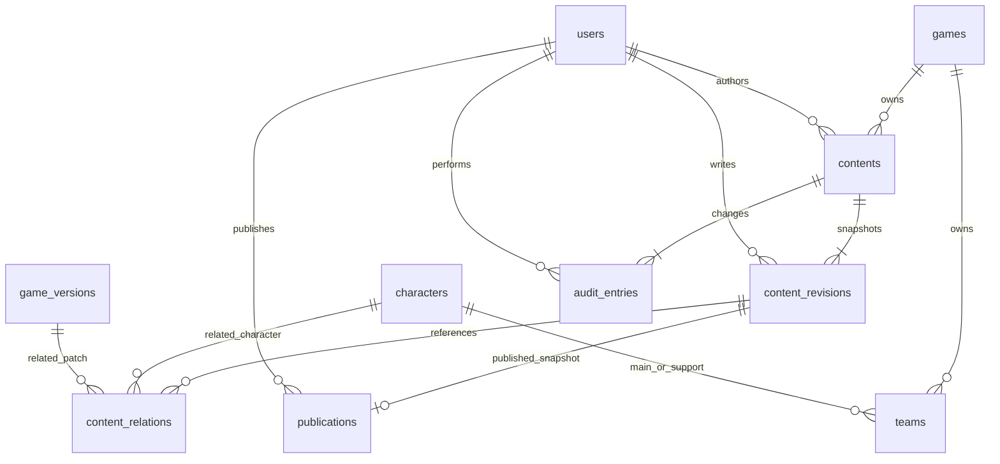

# Core publishing relationships

Revision identity is `(content_id, revision)`. Publication uses that composite
foreign key, so it cannot reference another guide's revision. One publication per
content exists at most. Relations belong to revisions, so draft changes cannot
alter a publication's associations. A relation references exactly one character or
game patch. Revision restore ancestry refers to an older revision of the same
content. Audit has a unique `(content_id, version)` key. Foreign-key lookup columns
have supporting indexes. Snapshots/relations/audit are append-only in PostgreSQL;
CMS tables use RLS with no direct public policies.

See [Phase 4](phase-4.md) for state transitions, counter semantics and transaction
boundaries. Catalog and identity schema details remain in their migration/entity
definitions and [Phase 2](phase-2.md)/[Phase 3](phase-3.md) notes.

Teams have three explicit member foreign keys (one Main, two Supports), each paired
with game_id to enforce same-game membership. Main and canonically sorted Supports
are unique per game, including archives. See [Team CRUD](teams.md).
